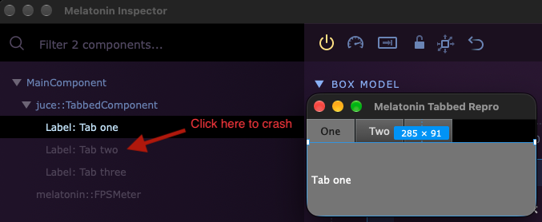

# Melatonin Tabbed Repro

## To reproduce

 - Open repro application
 - In Inspector's treeview, expand 'juce::TabbedComponent'
 - Click on an inactive tab component, i.e. 'Label: Tab two'

Reproduced on macOS 27 with JUCE 9.0.5.
